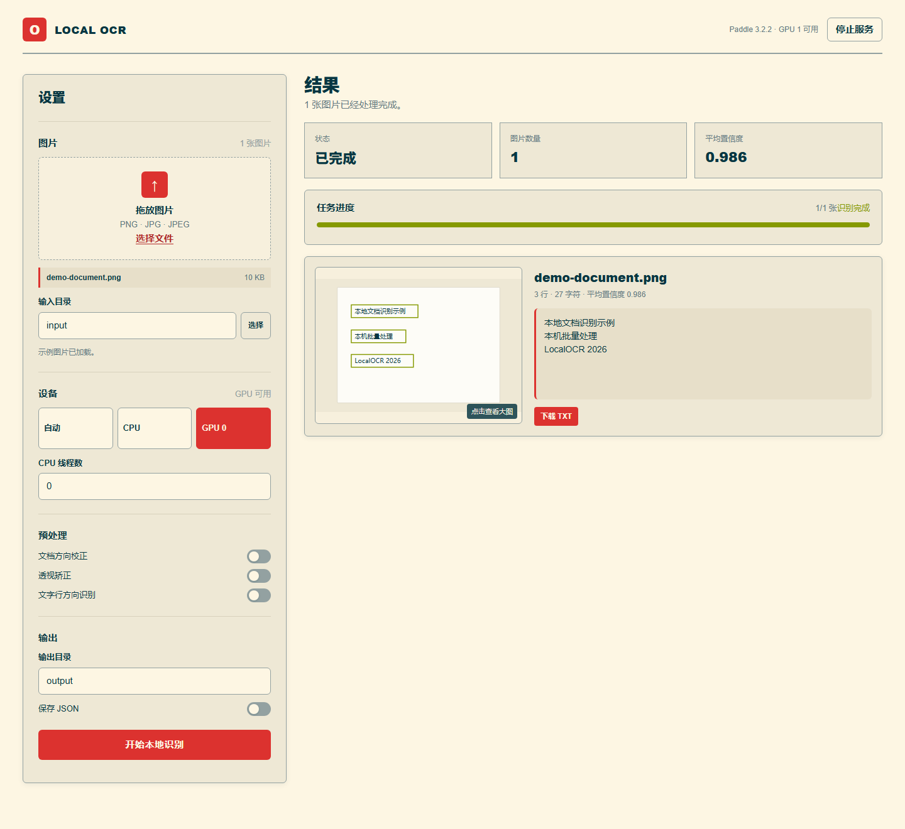

# LocalOCR

面向 Windows 的本地文档 OCR 工具。使用 PaddleOCR PP-OCRv5 批量识别 PNG、JPG 和 JPEG 图片，提供浏览器控制台与命令行两种使用方式，支持 CPU 和 NVIDIA GPU。



*本项目由GPT-Astra辅助开发*

## 功能

- **本地批量识别**：选择单张图片或目录，保存识别文本与标注图。
- **浏览器控制台**：拖放上传、配置输入输出目录、查看进度、预览图片与下载结果。
- **CPU / GPU 切换**：CPU 环境使用 `uv.lock`，GPU 环境使用独立的 `.venv-train`。
- **可选预处理**：文档方向校正、透视矫正、文字行方向识别。
- **结构化输出**：生成 TXT 与 `summary.csv`，可选保存详细 JSON。

## 为什么没有Release
原先已打包的便携版成品有若干分发许可证问题，故只放出项目源码

## 快速开始

需要 Windows 11、Python 3.12 和 [uv](https://docs.astral.sh/uv/)。在项目根目录打开 PowerShell，安装 CPU 依赖：

```powershell
powershell -ExecutionPolicy Bypass -File .\scripts\setup_cpu.ps1 -Verify
```

启动浏览器控制台：

```powershell
uv run python scripts/web_console.py
```

也可以双击 `open_ocr_studio.vbs`。打开页面后拖入图片、选择运行设备，点击 **开始本地识别**。默认结果保存在 `output/`。首次识别时会下载模型到 `models/paddlex/`，后续复用本地缓存。

### 使用命令行

将图片放入 `input/`，执行：

```powershell
uv run python scripts/run_ocr.py --input input --output output --device cpu
```

指定单张图片或启用预处理：

```powershell
uv run python scripts/run_ocr.py --input input/example.jpg --output output --device cpu --doc-orientation --unwarp
```

`--input` 接受图片文件或目录；`--device` 可选 `auto`、`cpu`、`gpu:0`；`--cpu-threads 0` 使用默认线程数；`--include-json` 额外保存详细结果。运行 `uv run python scripts/run_ocr.py --help` 查看全部参数。

### 使用 GPU

GPU 环境需要 NVIDIA 显卡及兼容 CUDA 12.9 的驱动。安装后使用独立的 `.venv-train` 运行：

```powershell
powershell -ExecutionPolicy Bypass -File .\scripts\setup_train.ps1 -Verify
.\scripts\run_ocr.ps1 -Gpu -InputPath input -OutputPath output
```

双击启动器会优先使用已安装的 GPU 环境，否则选择 CPU 环境。CPU 和 GPU 的安装目录相互独立。

GPU 推理依赖列在 `requirements-gpu.txt`。

## 输出文件

| 文件 | 内容 |
| --- | --- |
| `<图片名>.txt` | 识别到的文字，每行对应一个文字区域 |
| `<图片名>_ocr_res_img.png` | 带识别标注的图片 |
| `summary.csv` | 每张图片的识别行数、字符数、平均置信度和处理状态 |
| `<图片名>.json` | 可选的详细结果，使用 `--include-json` 或在控制台开启「保存 JSON」生成 |

浏览器上传的图片保存在 `input/web-console/session-*/`，可通过页面的 **删除本次上传副本** 按钮清理；其他批次与识别结果保留在本地目录中。控制台默认运行在 `127.0.0.1:8765`，可以点击页面上的 **停止服务** 退出。

## 项目结构

```text
LocalOCR/
├── scripts/
│   ├── run_ocr.py          # 批量识别与命令行入口
│   ├── web_console.py      # 本地控制台服务
│   ├── setup_cpu.ps1       # CPU 环境安装
│   └── setup_train.ps1     # GPU 环境安装
├── web/index.html          # 控制台界面
├── docs/console-demo.png   # 控制台示例图
├── requirements-gpu.txt    # GPU 推理依赖
├── packaging/              # 便携版构建脚本与使用说明
├── tests/                  # 单元测试
├── input/                  # 默认输入目录
├── output/                 # 默认输出目录
└── models/                 # 本地模型缓存
```

## 开发与测试

运行不依赖模型下载的单元测试：

```powershell
python -m unittest discover -s tests -v
```

`.github/workflows/tests.yml` 会在 Windows / Python 3.12 上执行同一组测试。项目内的输入图片、识别结果、模型缓存和虚拟环境均已配置在 `.gitignore` 中。

## 便携版构建

准备好 GPU 环境及已下载的模型后，可以使用 `packaging/build_delivery.ps1` 在本机构建 Windows 便携版。构建依赖 7-Zip、.NET Framework C# 编译器和 Microsoft Edge；输出文件为 `deliver/LocalOCR_Portable.exe`。运行该程序会在同级目录解压所需的 Python 环境、模型与本地控制台。
